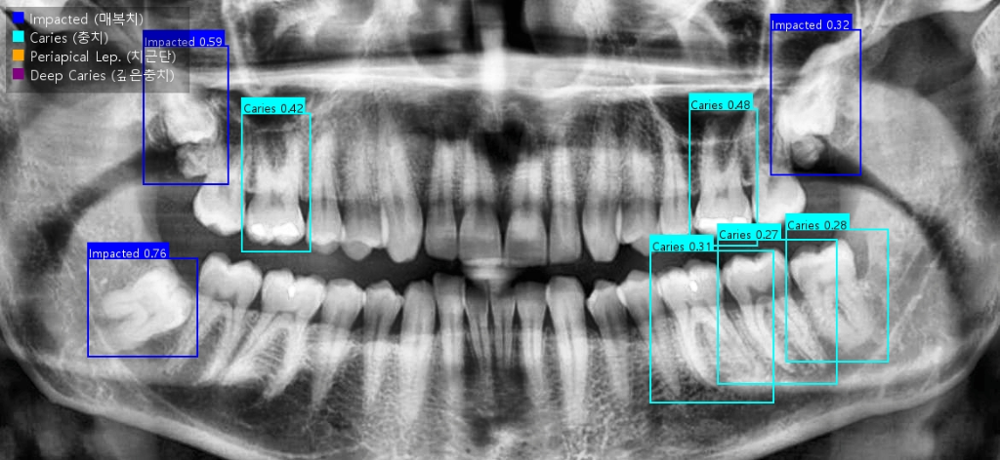
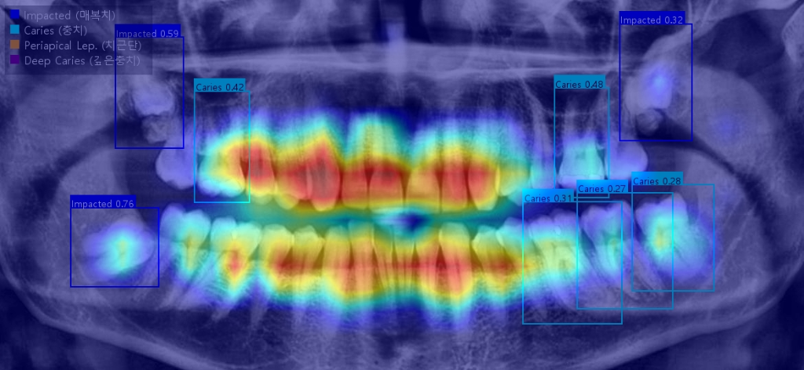

     

# Dental_002: Caries & Impacted Tooth Detection (파노라마 치아 우식증 및 매복치 탐지)

## 개요

`Dental_002`는 치과 파노라마 방사선 영상에서 치아 자체에 발생하는 병소(우식증, 심부 우식증 등)를 전담하여 검출하고 Streamlit 웹 UI 및 Eigen-CAM XAI 시각화를 제공하는 모듈입니다. 성인뿐만 아니라 혼합치열기(소아) 환자의 데이터까지 학습하여 다양한 연령대에서 활용 가능하도록 설계되었습니다.

> [!IMPORTANT]
> [아키텍처 역할 분리 (`Dental_002` vs `Dental_012`)]: 통합 파이프라인(`Dental_Panoramic_Reader`)에서 `Dental_002`는 오직 치관·치경부 치아 패치(`512x512`) 영역의 우식(Caries) 검출에만 집중합니다. 치근단(Periapical) 병소는 치조골 내부 영역이므로 도메인 중복을 피하기 위해 `Dental_012` 모듈로 전담 이관되었으며, 통합 파이프라인의 `Dental_002` 인터페이스에서는 `Periapical` 검출 결과를 의도적으로 필터링합니다.

- [학습 및 추론 하드웨어 사양]:
  - Training Env (메인 워크스테이션): AMD Ryzen 9 9900X, NVIDIA GeForce RTX 5080 (16GB VRAM), 64GB RAM
  - Development / Inference Env (랩탑 워크스테이션): Intel Core i5-14450HX, NVIDIA GeForce RTX 4060 Laptop GPU (8GB VRAM), 16GB RAM

---

## 주요 기능 및 아키텍처

### 1. 핵심 기능 및 분석 결과 예시


- [YOLO 기반 객체 탐지]: 파란색 박스는 매복치(Impacted), 청록색 박스는 충치(Caries)를 의미하며 높은 신뢰도로 치과 병소를 식별합니다.


- [Eigen-CAM XAI 분석]: 모델이 병소를 판별할 때 어느 영역에 시각적 주의(Attention)를 기울였는지 히트맵으로 시각화하여 판독 근거를 제시합니다.
- [단독 패키지(`dentex_caries`) 탐지 클래스]:
  - `Caries` (치아 우식증)
  - `Deep Caries` (심부 우식 / 치수 침범 의심)
  - `Periapical Lesion` (치근단 병소 — 단독 실행 시 지원, 통합 파이프라인에서는 `Dental_012`가 전담)
  - `Impacted` (매복치 — 단독 실행 시 지원, 통합 파이프라인에서는 `Dental_009` 기하 분석과 연계)
- [기술 스택]: YOLOv8 / YOLOv11 (Ultralytics), PyTorch, ONNX Runtime, OpenCV, Pillow, Streamlit
- [Dental_008 FDI 치아 매핑 및 HiTL 재학습 연동 (`src/dentex_caries/fdi_hitl_bridge.py`)]:
  - `map_caries_to_008_teeth`: `Dental_008` 치아 폴리곤(`pointPolygonTest`), 병변 면적 교집합 비율(`IoA`), 치관 영역 가중치를 결합하여 우식 병소를 정확한 FDI 치아 번호에 매핑하고 `PanoramaHiTLDocument`에 기록합니다.
  - `export_hitl_caries_to_yolo`: `Dental_015`에서 교정·저장된 Golden HiTL JSON(`dental_core.panorama_hitl.v1`)을 전장 파노라마(`mode='full'`) 또는 치아 패치(`mode='tooth_patch'`) YOLO 학습 라벨로 변환합니다.

### 2. 모델 가중치 (Model Weights on Hugging Face)
학습된 가중치는 Hugging Face Hub에 연동되어 있으며, 로컬에 `models/best_refined.pt`가 없는 경우 구동 시 자동 Fallback 다운로드가 작동합니다:
- [Hugging Face Repository (`chemahc94/Dental-AI-Models`)](https://huggingface.co/chemahc94/Dental-AI-Models/tree/main/Dental_002) (`best_patch.onnx`)
- [Hugging Face Repository (`chemahc94/caries-detection-weights`)](https://huggingface.co/chemahc94/caries-detection-weights) (`best.pt`, `best_refined.pt`)

```python
from huggingface_hub import hf_hub_download
hf_hub_download(repo_id="chemahc94/caries-detection-weights", filename="best_refined.pt", local_dir="models")
```

---

## 벤치마크 및 검증 성능

- [2-Stage 고해상도 치아 패치(`512x512`) 벤치마크 (`Dental_000/reports/260917_2120_Dental002_2Stage_Patch_Benchmark_Report.md`)]:
  - 분할 방식: 환자 단위 엄격 분리 검증셋
  - `Recall`: `94.1%`
  - `Precision`: `83.3%`
  - `mAP@0.5`: `91.5%`
- [단위 테스트 검증]: `dentex_caries` 코어 라이브러리 단위 테스트 `8 passed` 통과 완료.

---

## 데이터셋 출처 및 라이선스

- [DENTEX Challenge 2023 (Primary)]: MICCAI 2023 Grand Challenge에서 제공된 치과 파노라마 방사선 사진 공개 데이터셋(4가지 병소 어노테이션 포함, `CC BY-NC-SA 4.0`). [https://dentex.grand-challenge.org/](https://dentex.grand-challenge.org/)
- [Pediatric Dataset (Supplementary)]: 소아 혼합치열기 환자의 파노라마 공개 데이터셋(`CC0 1.0`)을 결합하여 연령대 커버리지를 확보함.
- [소스 코드 라이선스]: 본 저장소의 소스 코드는 `MIT License` ([LICENSE](LICENSE)) 하에 배포됩니다.

---

## 설치 및 실행 방법

### 1. 환경 설정 및 패키지 설치
이 프로젝트는 독립적인 Python 패키지(`dentex_caries`)로 설계되었습니다 (`data.yaml` 및 `data_refined.yaml`은 이식 가능한 상대 경로 `path: data/refined`를 사용하며, 학습/추론 시 CUDA/CPU 자동 폴백을 지원합니다):
```bash
# 개발자 모드로 패키지 및 의존성 설치 (권장)
pip install -e .

# 또는 requirements.txt 설치
pip install -r requirements.txt
```

### 2. 웹 애플리케이션 및 Docker 실행
```bash
# 로컬 Streamlit 앱 실행
streamlit run app.py

# Docker 이미지 빌드 및 백그라운드 실행
docker build -t dentex-caries .
docker run -d -p 8501:8501 dentex-caries
```

> [Troubleshooting — Streamlit Cloud 배포 시 OpenCV ImportError]:
> Streamlit Cloud 대시보드의 `App settings -> General -> Python version`이 `3.14` 등으로 설정된 경우 `cv2` 임포트 에러가 발생할 수 있으므로 Python 버전을 `3.11`로 지정하십시오.

### 3. Python 라이브러리 호출 및 단위 테스트
```python
import cv2
from dentex_caries import CariesDetector

detector = CariesDetector("models/best_refined.pt")
image = cv2.imread("panorama.jpg")
preds, processed_img = detector.predict(image)
heatmap, _ = detector.explain("panorama.jpg")
```

```bash
# 전체 단위 테스트 및 커버리지 확인
pytest tests/ --cov=src/dentex_caries --cov-report=term
```

---

## 참고 문헌 및 연구용 실행 주의사항

1. [DENTEX Challenge 2023]: [https://dentex.grand-challenge.org/](https://dentex.grand-challenge.org/)
2. [Ultralytics YOLO]: [https://github.com/ultralytics/ultralytics](https://github.com/ultralytics/ultralytics)
3. [Sevik, U. et al. (2025)]: Detection of Dental Anomalies in Digital Panoramic Images Using YOLO.
- [가중치 백업 안내]: 오래된 이전 가중치 파일(Legacy Backups)은 `Emergency_Weights_Vault/Dental_002/Backup_Checkpoints` 폴더에 별도로 보존되어 있습니다.
- [연구용 실행 주의사항]:
  - 기본 실행 주소: `127.0.0.1` (로컬 전용)
  - 외부 공개/상용 배포 금지 및 오픈 데이터셋 외 민감 의료데이터 사용 금지
  - API 키·토큰은 환경변수로만 관리하며, 외부 접근이 필요하면 `ALLOW_EXTERNAL_ACCESS=true`로만 명시적 허용
